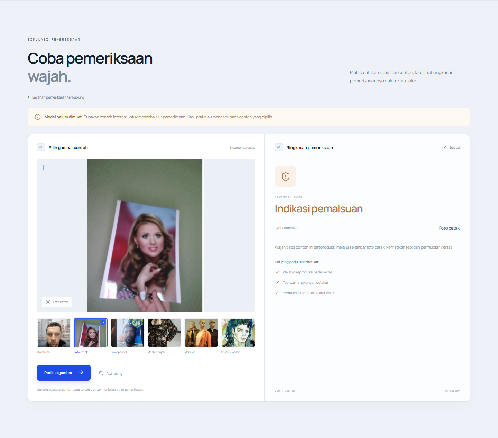
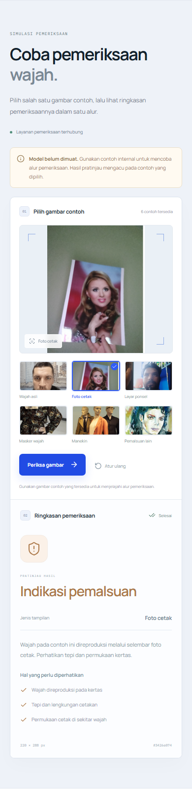

# Face Spoofing Detection

A face presentation-attack detection project with a client-facing landing page and research notebooks using DINOv3, ConvNeXt, and FSFM.

## Explore the website

The landing page focuses on identity-verification needs: recognizing presentation attacks, examining image context and facial detail, and exploring registration, identity-review, and service-access use cases. The gallery has animated filters, six image cards, and a detail viewer with previous/next controls, arrow-key navigation, Escape, focus management, and a mobile layout. Experiment details remain in the research documentation.

The gallery and simulation use six dataset samples recovered from embedded outputs in the original cleaning notebook. The PNG excerpts and lossless WebP versions retain those saved pixels; they are not the original full-resolution JPEG files. Labels follow the notebook and are not new model predictions. See the [sample provenance](docs/assets/dataset/README.md). Hero and supporting visuals remain editorial illustrations. The simulation calls a lightweight API using internal examples only; no user uploads are accepted.

```bash
# Download code without the large checkpoint binaries.
GIT_LFS_SKIP_SMUDGE=1 git clone --depth 1 https://github.com/Ditt-A/Face-Spoofing-Detection.git
cd Face-Spoofing-Detection/frontend
npm ci
npm run dev
```

Open **http://localhost:3001**. Node.js 22 LTS is recommended. On PowerShell, set `$env:GIT_LFS_SKIP_SMUDGE = '1'` before running the normal `git clone` command.

## Try the simulation

Open **http://localhost:3001/#simulasi** after starting the backend. Choose one of six internal examples, run a check, and inspect the result. The UI clearly reports that the model is not loaded and shows a reference preview. API requests, selection changes, cancellation, reset, and retry work without loading any checkpoint.

```powershell
# From the repository root, in a second terminal (Python 3.11+).
python -m venv .venv
.\.venv\Scripts\python.exe -m pip install -r backend/requirements.txt
$env:FSD_ENABLE_MODEL = '0'
.\.venv\Scripts\python.exe -m uvicorn app.main:app --app-dir backend --host 127.0.0.1 --port 8301
```



API docs: **http://127.0.0.1:8301/docs**. See [backend setup](backend/README.md) and the [model integration contract](docs/api.md). The real-model adapter remains a separate integration step; this service includes an explicit loading gate and reference fallback.

<details>
<summary>Mobile simulation preview</summary>



</details>

## Repository layout

```text
Face-Spoofing-Detection/
├── frontend/                  # Standalone React + TypeScript + Vite website
│   ├── src/
│   │   ├── components/        # Interactive gallery, simulation, and reveals
│   │   ├── styles/            # Layout, gallery, sections, responsive motion
│   │   ├── data.ts            # Gallery descriptions and client use cases
│   │   └── App.tsx
│   ├── public/
│   │   ├── assets/images/     # Dataset samples and supporting WebP assets
│   │   └── brand/             # Native SVG mark / favicon
│   └── e2e/                   # Desktop and mobile interaction tests
├── backend/
│   ├── app/                   # FastAPI, internal fixtures, schemas, provider gate
│   ├── tests/                 # No-load, fallback, and integration-contract checks
│   └── requirements.txt       # Lightweight API dependencies; no ML runtime
├── notebooks/
│   ├── Data_Cleaning.ipynb
│   └── Modelling.ipynb
├── model/                     # Checkpoints via Git LFS + saved probabilities
└── docs/
    ├── methodology.md         # Research, environment, data, and notebook guide
    ├── development.md         # Frontend setup and verification
    ├── api.md                 # API / fallback / future predictor contract
    ├── assets/                # Dataset provenance, placement, manifests, prompts
    └── images/                # Screenshots of the running website
```

## Research pipeline

The task distinguishes `realperson` from `fake_printed`, `fake_screen`, `fake_mask`, `fake_mannequin`, and `fake_unknown`.

1. **Clean and review:** DINOv3 embeddings, duplicate detection, and class-centroid anomaly review. The documented cleaning experiment reduced 1,652 images to 1,427.
2. **Preserve two views:** full image plus expanded face crop, with a center-crop fallback.
3. **Train complementary branches:** DINOv3 ViT-H+ (RGB, LoRA), DINOv3 ConvNeXt-Large (RGB + FFT), and FSFM ViT-B/16 (face-specific pretraining, LoRA).
4. **Fuse predictions:** test-time augmentation and probability averaging, with an optional rule-based meta-layer.

See the [methodology and notebook guide](docs/methodology.md) for dataset structure, dependencies, training, and inference. Notebook outputs have been cleared for a lightweight source checkout; historical outputs remain in Git history. Research cells were not executed while building the website.

### Saved artifacts

`model/` contains ConvNeXt and FSFM checkpoint pointers and three probability arrays. Download checkpoint binaries with `git lfs pull` only when needed for research. The ViT-H+ checkpoint and some optional meta-layer inputs are not included; these limitations are described in the methodology guide.

## Frontend checks

```bash
cd frontend
npm run build
npx playwright install chromium
npm run test:e2e
```

Install `backend/requirements-dev.txt` into the root `.venv` before browser checks. Playwright starts the frontend and API on isolated ports 4174 and 8311 with model loading disabled. Backend checks run with `.venv/Scripts/python.exe -m pytest backend/tests -q` on Windows (or `.venv/bin/python` on macOS/Linux).

The production build is emitted to `frontend/dist/`. A static host must provide an `/api` reverse proxy to enable the simulation; the landing page and gallery remain usable independently.

## Visual assets

See the [asset placement guide](docs/assets/README.md), [dataset provenance manifest](docs/assets/dataset/manifest.json), and [original editorial generation prompts](docs/assets/prompts.md). The six recovered dataset WebPs total about 324 KB. True alpha is preserved for the editorial hero portrait and camera. Unused editorial gallery prototypes are retained as design-source assets, while the live gallery and simulation use only the dataset-derived samples.
