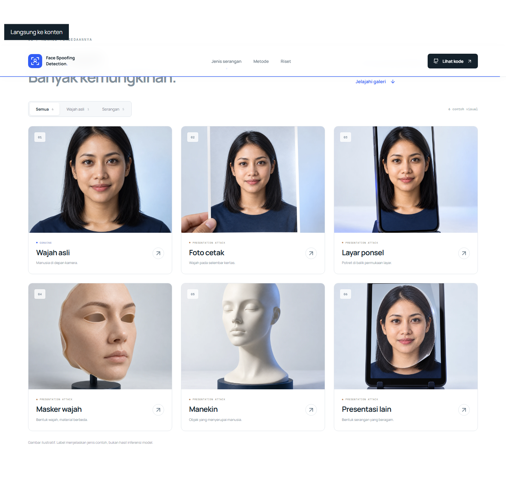
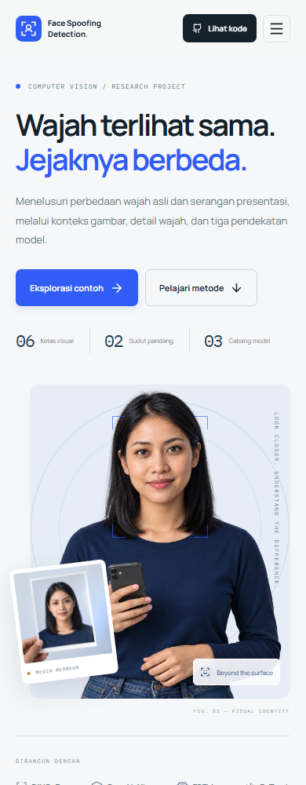

# Face Spoofing Detection

A visual introduction to a six-class face presentation-attack research pipeline, with an interactive gallery and notebook-based experiments using DINOv3, ConvNeXt, and FSFM.


## Explore the website

The landing page introduces the six classes, full-image and face-crop inputs, three model branches, and the dataset-cleaning process. The gallery has animated filters, six image cards, and a detail viewer with previous/next controls, arrow-key navigation, Escape, focus management, and a mobile layout.

All ten photographic assets are synthetic editorial illustrations. Gallery labels explain the examples; they are not model predictions. The frontend runs independently of Python, datasets, checkpoints, and GPUs.

```bash
# Download code without the large checkpoint binaries.
GIT_LFS_SKIP_SMUDGE=1 git clone --depth 1 https://github.com/Ditt-A/Face-Spoofing-Detection.git
cd Face-Spoofing-Detection/frontend
npm ci
npm run dev
```

Open **http://localhost:3001**. Node.js 22 LTS is recommended. On PowerShell, set `$env:GIT_LFS_SKIP_SMUDGE = '1'` before running the normal `git clone` command.



<details>
<summary>Mobile preview</summary>



</details>

## Repository layout

```text
Face-Spoofing-Detection/
├── frontend/                  # Standalone React + TypeScript + Vite website
│   ├── src/
│   │   ├── components/        # Interactive gallery and reveal animation
│   │   ├── styles/            # Layout, gallery, sections, responsive motion
│   │   ├── data.ts            # Class descriptions and model specifications
│   │   └── App.tsx
│   ├── public/
│   │   ├── assets/images/     # Ten optimized WebP assets
│   │   └── brand/             # Native SVG mark / favicon
│   └── e2e/                   # Desktop and mobile interaction tests
├── notebooks/
│   ├── Data_Cleaning.ipynb
│   └── Modelling.ipynb
├── model/                     # Checkpoints via Git LFS + saved probabilities
└── docs/
    ├── methodology.md         # Research, environment, data, and notebook guide
    ├── development.md         # Frontend setup and verification
    ├── assets/                # Placement guide, manifest, and exact prompts
    └── images/                # Screenshots of the running website
```

## Research pipeline

The task distinguishes `realperson` from `fake_printed`, `fake_screen`, `fake_mask`, `fake_mannequin`, and `fake_unknown`.

1. **Clean and review:** DINOv3 embeddings, duplicate detection, and class-centroid anomaly review. The documented cleaning experiment reduced 1,652 images to 1,427.
2. **Preserve two views:** full image plus expanded face crop, with a center-crop fallback.
3. **Train complementary branches:** DINOv3 ViT-H+ (RGB, LoRA), DINOv3 ConvNeXt-Large (RGB + FFT), and FSFM ViT-B/16 (face-specific pretraining, LoRA).
4. **Fuse predictions:** test-time augmentation and probability averaging, with an optional rule-based meta-layer.

See the [methodology and notebook guide](docs/methodology.md) for dataset structure, dependencies, training, and inference. Notebook outputs have been cleared for a lightweight source checkout; historical outputs remain in Git history. Research cells were not executed while building the website.

### Saved artifacts

`model/` contains ConvNeXt and FSFM checkpoint pointers and three probability arrays. Download checkpoint binaries with `git lfs pull` only when needed for research. The ViT-H+ checkpoint and some optional meta-layer inputs are not included; these limitations are described in the methodology guide.

## Frontend checks

```bash
cd frontend
npm run build
npx playwright install chromium
npm run test:e2e
```

Browser checks use the standalone frontend; they do not load any research model. The production build is emitted to `frontend/dist/` and can be served by a static web host.

## Visual assets

See the [asset placement guide](docs/assets/README.md), [manifest](docs/assets/manifest.json), and [exact generation prompts](docs/assets/prompts.md). The website uses approximately 1.3 MB of WebP imagery, with true alpha preserved for the hero portrait and camera.
